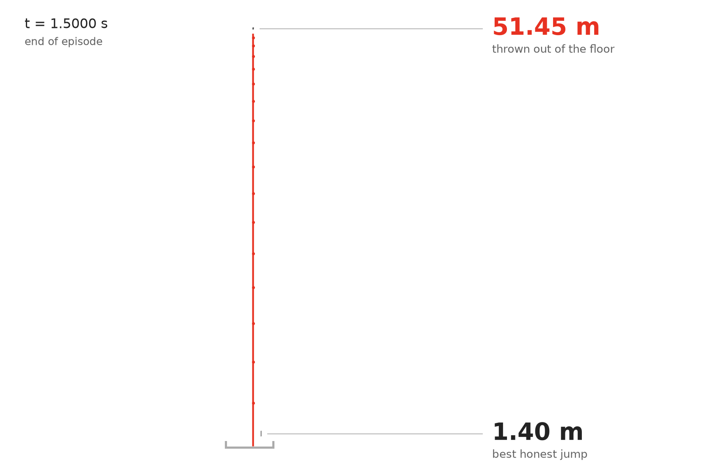
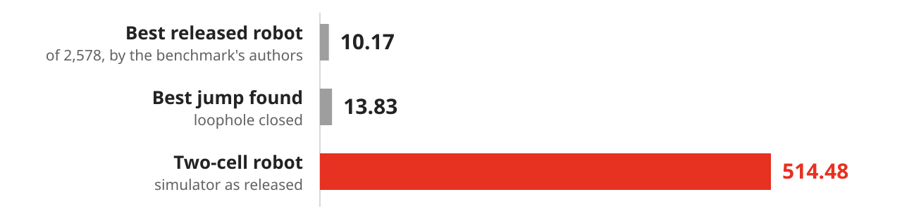
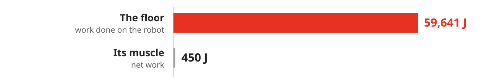
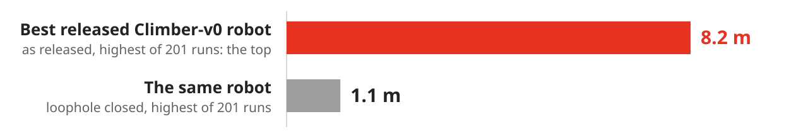

# 514.48 on Jumper-v0. The robot never jumps.

<p align="center">
  <picture>
    <source media="(prefers-color-scheme: dark)" srcset="figures/launch-dark.gif">
    
  </picture>
</p>

**A two-cell robot falls through the floor of Evolution Gym, and the floor throws it 51 metres into the air. That scores 514.48 on Jumper-v0. An estimated 97% of it is a contact exploit. Patched, the best design found scores 13.83.**

The same two cells, with nothing changed, also reach the top of Climber-v0 and Climber-v1. And the benchmark's own search got there first: the best of the 3,417 Climber-v0 robots its authors released is a column of four muscles that does not climb. The floor throws it.

[Evolution Gym](https://github.com/EvolutionGym/evogym) is a benchmark for designing a soft robot's body and its controller together. A robot is a 5 × 5 grid of rigid, soft and muscle cells. In Jumper-v0 it earns 10 points for every metre its centre of mass ends above where it began. The highest of the 2,578 Jumper-v0 scores the benchmark's authors have released is 10.17.

<picture>
  <source media="(prefers-color-scheme: dark)" srcset="figures/score-dark.svg">
  
</picture>

Give an optimiser a simulator and a score, and it finds where the physics is wrong. That has been known [for thirty years](https://arxiv.org/abs/1803.03453). This is one such place in a benchmark in use today, taken apart to the line of code: how it works, where the energy comes from, how far it reaches, who stands on it, and how to close it.

## How it works

<picture>
  <source media="(prefers-color-scheme: dark)" srcset="figures/mechanism-dark.svg">
  
</picture>

The floor is a row of 10 cm tiles. The simulator pushes a corner out of a tile only through an edge that the corner's own side crosses. Squeeze the robot's bottom cell by the width of a hair and each bottom corner sits in one tile while its side crosses the top of the next. Neither tile pushes. The cell drops through solid ground.

It stops at the underside of the floor, sitting where a tile is. Then its sides straighten, the rule fires with the corners 9.7 cm deep, and the force grows with depth: four contacts of 214,000 N on a 6 kg robot. 1.2 milliseconds later it is leaving at 110 m/s.

Two lines do it, `PhysicsEngine.cpp` 1026 to 1027, unchanged since the first public commit:

```cpp
if (ref_edges_index.size() == 0)
    return;
```

[Step by step, with every force and line number.](docs/mechanism.md)

## The floor does the work

<picture>
  <source media="(prefers-color-scheme: dark)" srcset="figures/energy-dark.svg">
  
</picture>

Every joule the robot gains is assigned to a force, step by step, and the account closes to 2 parts in 10¹⁶. The floor supplies 59,641 J, 95% of it in twelve time steps. The muscle supplies 450 J. It is a trigger.

## It is not one task

All 32 of the benchmark's tasks share the contact routine. Put this robot and its 500 commands, found for Jumper-v0, into every one of them and change nothing: the floor throws it in 22. In three it outscores every robot the benchmark's authors released.

| Task, as the paper rates it | This robot, unchanged | Loophole closed | Best robot the authors released |
|---|---:|---:|---:|
| Jumper-v0, easy | 514.48 | -1.99 | 10.17, of 2,578 |
| Climber-v0, medium | 9.45, at the top by command 230 of 400 | -0.20 | 9.27, of 3,417: [thrown too](#who-stands-on-it); the next scores 5.49 |
| Climber-v1, medium | 7.32, at the top by command 223 of 600 | -0.20 | 4.13, of 2,162; none reaches the top |

Climber-v0 is one of the ten tasks the paper compares its methods on. Nothing was searched for either climb: these are the Jumper-v0 commands, replayed. [All 32 tasks.](results/other_tasks.csv)

## Who stands on it

**One robot in the benchmark's own data.** Of the 3,417 Climber-v0 robots the authors released, the best scores 9.27 and the next 5.49. The best is a column of four muscles. Run with its released controller (the run that scored 9.27 is not released), the floor throws it 5.8 m up the channel, and in 2 of 200 runs with the controller's own noise to the top, for 9.24 and 9.21. With the loophole closed it never rises more than 1.1 m, in 201 runs. A second column of four muscles in the same data does the same.

<picture>
  <source media="(prefers-color-scheme: dark)" srcset="figures/climber-dark.svg">
  
</picture>

**Nobody on Jumper-v0**, that could be found. None of the authors' 2,578 scores passes 10.17. For 78 they released the controller: run on x86-64 Linux as released and with the loophole closed, nine runs each, those 78 average 3.40 and 3.38, a difference of 0.02 ± 0.05; run once each in the shipped wheel's arithmetic on Apple silicon, 2.81 and 2.58, a difference of 0.23 ± 0.11. The benchmark's baseline, rerun here with its example code on 1,345 bodies, tops out at 3.66. The highest score in a paper is 9.17, or 14.50 on a 7 × 7 body, where a jump with the loophole closed reaches 17.36.

A direct search over commands fell into the loophole under sixteen rule settings out of sixteen. Reinforcement learning fell into it on the climb and, in 3,923 robots, never on the jump. [The measurements.](docs/evidence.md#who-stands-on-the-loophole)

## Close it

One added case closes it: [`patches/close-loophole.patch`](patches/close-loophole.patch). A point stranded inside fixed terrain is pushed out through the nearest exposed side of its cell, if that side is under half a cell away. The same robot then scores -1.99. The best design found with it closed is a column of five muscles that jumps 1.40 m and scores 13.83, and the same unpatched on x86-64 Linux; in the shipped wheel on Apple silicon the floor throws it too, for 58.52. Both scores are the best a search found, not proved maxima, which makes the 97% an estimate.

The case is not rare. Run once each in the shipped wheel's arithmetic on Apple silicon, the 2,545 released controllers that run there meet it in 802 episodes, at a median depth of 0.5 mm, and those then take another path: 801 scores change, 97 by more than a point, by -0.002 ± 0.011 on average. The 1,743 it never touches score the same to the last bit. [Every robot.](results/released_fix.csv)

The obvious patch is six lines, and it has a hole of its own. Evolution Gym's test for whether a point is inside a cell passes for any point on the line through two of the cell's corners, so [`close-loophole-plain.patch`](patches/close-loophole-plain.patch) also pushes corners that are not in the floor: 220,500 N on a corner 10 cm above it, before the robot has moved. Under that patch the best design found scores 14.20. As released, the same design scores 12.22. [The second bug.](docs/evidence.md#the-plain-patch)

Pushing every stranded point up through its cell's top, even once it is tested to lie inside the cell ([`close-loophole-top.patch`](patches/close-loophole-top.patch)), leaves a third: a point touching a peg or a ceiling from below goes up through the whole cell, with up to 220,000 N. That happens more than 2 cm deep to 37 released robots, and lifts the top BeamToppler-v0 score from 9.41 to 11.46. [The third bug.](docs/evidence.md#the-top-edge-patch)

Change the box, the materials, the time step, the muscle range, the contact timing: sixteen rule settings in all, and in every one the best design found is the launch, with 95.1% to 99.9% of its score from the loophole. [The table.](docs/rules.md)

## Run it

```
pip install "evogym==2.0.0" "setuptools<70"     # Evolution Gym as its authors ship it
python scripts/quick.py                         # cells 2   score 514.48   centre of mass rose 51.45 m
```

To take it apart, build it from source, as released and patched:

```
pip install -r requirements.txt
bash scripts/setup.sh
python scripts/diagnose.py designs/best-stock/design.json    # jump, or launch?
python scripts/check.py                                      # 90 numbers, recomputed
```

The wheel needs Python 3.8 to 3.10. The check is exact on x86-64 Linux; on Apple silicon three of its 90 values differ in the second decimal place. [What was checked and how.](docs/evidence.md) [Reproduce it.](docs/reproduce.md)

## Cite

```bibtex
@misc{bogdan2026jumper,
  author = {Bogdan, Philipp},
  title  = {514.48 on Jumper-v0 without jumping: a contact loophole in Evolution Gym},
  year   = {2026},
  url    = {https://github.com/philippbogdan/evogym-jumper-loophole}
}
```

The benchmark is Evolution Gym: Bhatia, Jackson, Tian, Xu and Matusik, [NeurIPS 2021](https://arxiv.org/abs/2201.09863). Ours is public domain, [CC0 1.0](LICENSE); what derives from Evolution Gym keeps [its licence](THIRD_PARTY_NOTICES.md).
