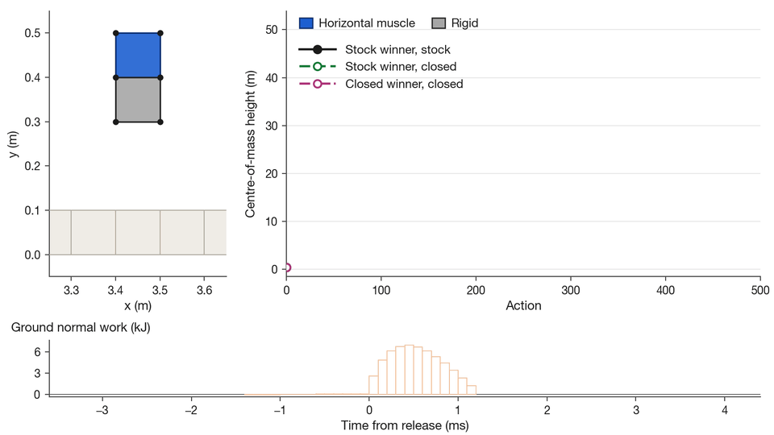
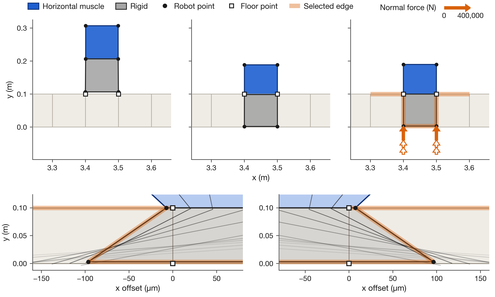
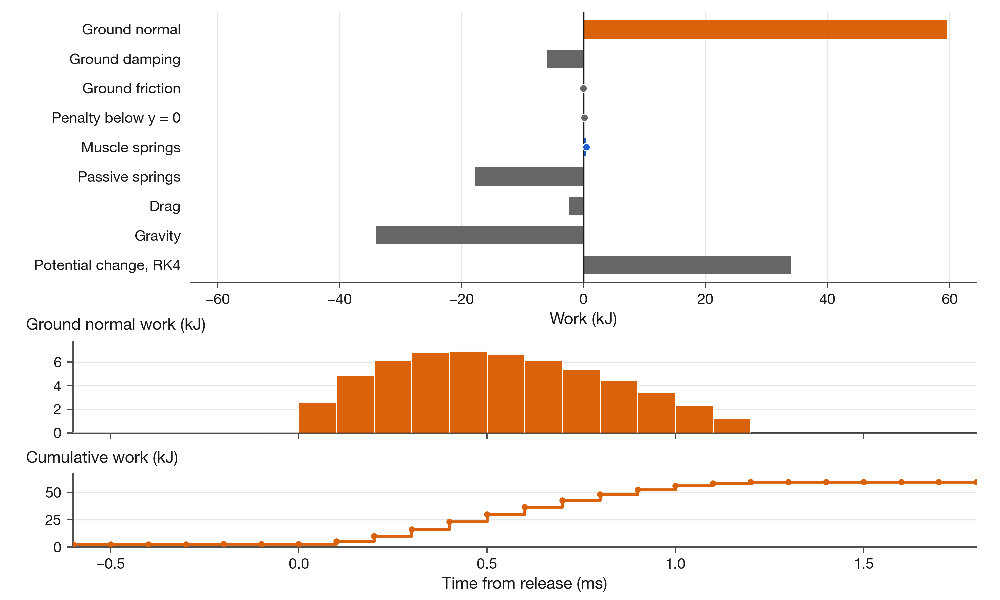
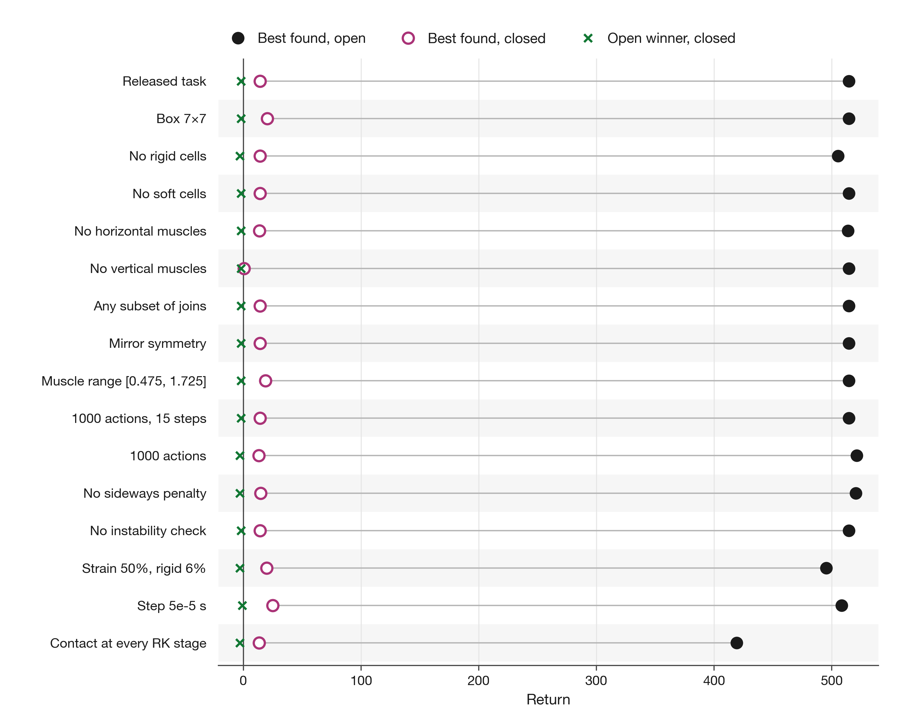

# Where Jumper-v0 gets its lift

Evolution Gym is an open benchmark for designing soft robots' bodies and controllers together (Bhatia et al., NeurIPS 2021). Each robot is a small grid of cells: empty, rigid, soft, or a muscle that stretches horizontally or vertically. In Jumper-v0, a robot of up to 5 × 5 cells on flat ground gets 500 muscle commands and earns 10 points per metre its centre of mass rises, minus a penalty for sideways movement. The simulator represents cell corners as point masses joined by springs, advances them in time steps of 0.0001 s, and handles contact with a penalty force that grows as a point penetrates another cell. Here, a two-cell robot sinks into the floor and is thrown 51 m upwards, giving the best score found: **514.48**. With this contact loophole closed, the best design found is a different robot scoring **14.20**, putting the estimated share of the best score attributable to the loophole at **about 97%**.

The two-cell robot sinks into the floor, then its centre of mass rises 51.45 m. The animation is slowed through the 12-step release so you can see it.

Check in minutes whether a high Jumper-v0 score comes from jumping or from the simulator's floor: **an estimated 97.2% of the best score found comes from a contact loophole**. A two-cell robot scores **514.48** in unmodified Evolution Gym; the best design found with the loophole closed scores **14.20**.

## How the floor launches the robot

The contact rule misses the robot's bottom corners near floor-cell boundaries, letting them sink. When [contact engages](patches/README.md#why-contact-is-missed), both its own corners and the floor corners trapped inside it push the robot upwards with forces that grow with depth.

A small change in the robot's shape triggers a strong upward push while it is deep in the floor. The close-ups show where its sides move across a floor-cell boundary and contact begins.

## The energy comes from contact

The floor's normal force supplies **59,641 J**, with **95% arriving in 12 integration steps**, compared with **450 J** of net muscle work. The robot ends with **34,105 J** more kinetic and gravitational energy; [the full account](REPRODUCE.md#account-for-the-energy) tracks the losses too.

The floor supplies far more energy than the muscles. The sharp burst at release shows how quickly that energy enters the robot.

## Close the loophole, then compare

Closing the missed contact drops the same robot's score from **514.48 to -1.99**. The best design found under the closed rules scores **14.20**.

The gap between open and closed scores persists across every rule setting tested. The replayed winners show how much their scores depend on the loophole.

The same mechanism appears in all **16 rule settings**, including the released task, with estimated shares of **95.1% to 99.9%**. Changing the body rules, action timing or how often contact forces are calculated does not remove it; [the table and rule definitions](patches/README.md#rule-comparisons) give every result.

## Guarding benchmark comparisons

Alongside scores, measure how far a robot enters the floor and how much energy the floor supplies. Replay promising designs with the [analysis patch](patches/close-loophole.patch) before using their scores to compare jumping ability.

The environment and simulator are [Evolution Gym](https://github.com/EvolutionGym/evogym), commit `f63c649`. Credit: J. S. Bhatia, H. Jackson, Y. Tian, J. Xu and W. Matusik, *Evolution Gym: A Large-Scale Benchmark for Evolving Soft Robots*, NeurIPS 2021 ([paper](https://arxiv.org/abs/2201.09863)).

## What this does not show

- The best-found scores are lower bounds, not limits. The percentage is an estimate, and the closed searches were smaller.
- The patch isolates the mechanism; it is not a proposed benchmark repair.
- The energy account checks the simulator's transfers, not physical conservation.
- Exact results are verified on x86-64 Linux with glibc. Some designs change substantially on a Mac; see [platform results](REPRODUCE.md#platform-agreement).

## How to use it

Load a [body and its action array](designs/README.md), [run the check or a single replay](REPRODUCE.md), or port the contact case using the [engine](engine/README.md), [patches](patches/README.md) and [figure reading guide and CSV traces](figures/README.md). Our original code, data, figures and text are free to use under [CC0](LICENSE); bundled third-party material keeps its [licences and notices](THIRD_PARTY_NOTICES.md).
