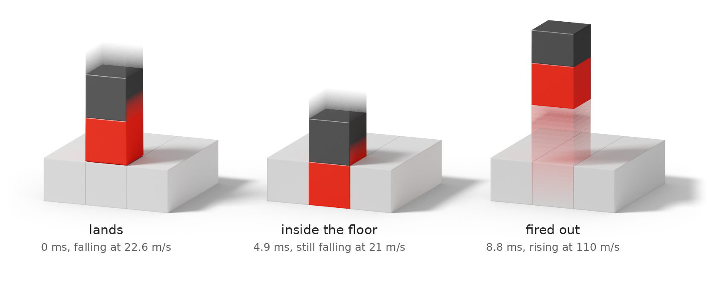

# How the floor launches the robot

<picture>
  <source media="(prefers-color-scheme: dark)" srcset="../figures/inside-dark.png">
  
</picture>

Everything here is read off the simulator's own source and its own state, step by step. Line numbers refer to `evogym/simulator/SimulatorCPP/` at Evolution Gym commit `f63c649`. Step numbers are integration steps of the best design, [`designs/best-stock`](../designs/best-stock): 30 steps per command, 0.0001 s each. Every contact of steps 5990 to 6081 is in [`figures/data/release_contacts.csv`](../figures/data/release_contacts.csv).

## 1. The rule

A robot is point masses on springs. The floor is a row of fixed square cells, 0.1 m each. When a point of one object is inside a cell of another, `resolve_point_boxel_collisions` pushes it out:

1. It lists the surface edges of the cell the point is in.
2. It keeps only those that one of the point's own two cell edges crosses (`PhysicsEngine.cpp:943-959`).
3. It pushes the point along the normal of the nearest kept edge with a force of 2,100,000 N/m × (0.005 m + distance to that edge) (`PhysicsEngine.cpp:1041`, constants at `PhysicsEngine.h:21,23`), and pushes the two ends of that edge back with half each (`:1057-1059`).

If step 2 keeps nothing, the routine returns:

```cpp
if (ref_edges_index.size() == 0)
    return;
```

`PhysicsEngine.cpp:1026-1027`. A point inside solid ground, and no force on it. The file has not changed since the first public commit of Evolution Gym (26 January 2022). Commit `f63c649` is the head of its main branch and has the same simulator as release 2.0.0 on PyPI.

## 2. The miss

The robot's cells and the floor's cells sit on the same 0.1 m lattice, so a robot's bottom corners start exactly on floor-cell boundaries. Squeeze the bottom cell into a slight trapezoid, wider at the bottom, and each bottom corner sits just inside the *neighbouring* floor cell while its side edge crosses the floor's top inside the *middle* one. The neighbouring cell contains the corner, but none of its surface edges is crossed. The middle cell's top is crossed, but it does not contain the corner. Neither pushes.

The offsets are tiny. The robot arrives at 22.6 m/s. At step 6003, the first with its bottom corners below the surface, they are 66 micrometres outside the boundaries x = 3.4 and x = 3.5, and the bottom cell's top corners are 727 micrometres inside them.

## 3. Through the floor

For two steps the contact is ordinary: four forces of 10,698 N and then 15,194 N slow the robot to 20.5 m/s. By then each bottom corner is 4 mm deep and its side edge crosses the middle cell's top. From step 6005 to step 6051 there is no contact force on the robot at all. The bottom cell travels down through the floor at 21 m/s.

At step 6052 two things stop it: its bottom corners pass y = 0, the underside of the floor, where a separate rule holds up any point below the world (`PhysicsEngine.cpp:569-573`, 14,000,000 N/m), and its top corners arrive at the floor's surface, where contact is ordinary. The bottom corners get 6.4 mm below the underside.

The bottom cell now occupies the place of a floor cell. That floor cell's two top corners are inside the robot. The robot rebounds at 12.9 m/s.

## 4. The release

At step 6066 the bottom cell's top corners come back above the floor's surface, 7.3 micrometres on the outer side of the boundaries. Each side edge now crosses the top of the cell its bottom corner is in. The rule fires, with the corner 9.69 cm deep:

| Contact | Force |
|---|---:|
| Left bottom corner, pushed up through its floor cell's top | 213,965 N |
| Right bottom corner, the same | 213,965 N |
| Floor corner at (3.4, 0.1), inside the robot, pushed out through the robot's bottom edge; the reaction lifts both bottom corners | 213,965 N |
| Floor corner at (3.5, 0.1), the same | 213,965 N |

2,100,000 × (0.005 + 0.09689) = 213,965. Each bottom corner, a 1 kg point, carries 427,930 N.

Twelve steps later, at step 6078, the robot is clear of the floor and rising at 110.3 m/s. Its bottom corners peaked at 124.7 m/s. Gravity in this simulator is 110 m/s² (`PhysicsEngine.h:18`), so 110 m/s carries it about 50 m.

The same trick, smaller, happens once before: around step 1764 the robot goes through the floor and is thrown to 2.57 m, and it is the fall from there that sets up the big one.

## 5. The energy

The robot's mechanical energy is the sum over its six points of v²/2 + 110 y. Every step, the change in it is split exactly among the forces of the update rule ([`scripts/energy.py`](../scripts/energy.py)). Over the whole episode:

| Term | Work (J) |
|---|---:|
| Floor, normal force | +59,641 |
| Floor, damping | -6,057 |
| Floor, friction | -13 |
| Rule below y = 0 | +146 |
| Muscle springs | +450 |
| Passive springs | -17,740 |
| Drag | -2,323 |
| **Robot gains** | **+34,105** |

The terms sum to the gain with a relative residual of 2.4 × 10⁻¹⁶. 56,883 J of the floor's work, 95%, arrives in the twelve steps of the release. The muscle's net contribution is 450 J: it is a trigger, not an engine.

## 6. Why 514

The number can be had with a pencil, to within a few percent. This is an estimate, not a bound.

- One contact released from depth D = 0.1 m, if its force followed the position, delivers 2,100,000 × (0.005 D + D²/2) = 11,550 J. Four deliver 46,200 J.
- The force does not follow the position. It is computed once per step and held, while the corner moves up to a centimetre in that step. Measured, the twelve steps deliver 56,883 J. With contact forces recomputed at every stage of the integrator the best design found delivers 48,143 J in its release and scores 419.08 ([rule setting `contact`](rules.md)).
- The springs, damping and drag take 43%. The robot keeps 34,105 J.
- 34,105 J lifts 6 kg by 34,105 / (6 × 110) = 51.7 m. The design's centre of mass rises 51.45 m and is still moving at 7 m/s when the episode ends.

Nothing in this says a different body could not get more. A column cell hides two corners and swallows two floor corners: four contacts. No design with more was found.

## 7. The patch

[`patches/close-loophole.patch`](../patches/close-loophole.patch) adds one case to the routine. When a free point lies within a fixed cell and no edge qualifies, it is pushed out through the cell's nearest surface edge, as any other contact is, if that edge is less than half a cell away. Nothing else changes: a robot that never meets the case behaves identically, bit for bit.

It handles a point of a robot or a loose object inside fixed terrain: floor, wall, peg or ceiling. It leaves as they are the reverse case, a terrain point inside a robot cell, and any point inside a robot or a loose object.

"Within" is tested against the cell's corners, not with the simulator's own containment test, and [the reason is a second bug](evidence.md#the-plain-patch). The half-cell limit is there because a point farther than that from every exposed side of its cell is nearer a side the cell shares with another, and a push through the far side is [a third](evidence.md#the-top-edge-patch).
